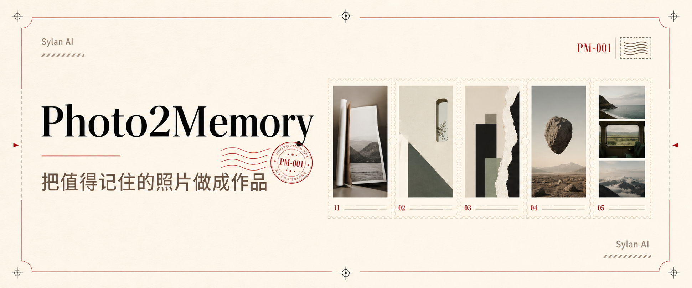

# Photo2Memory

**把值得记住的照片做成作品。**

Photo2Memory 收集并验证以真实照片为输入的 AI 创作 Skill，帮助你把旅行、看展和日常生活中的重要时刻，重新做成纸刊、海报、抽象视觉、超现实影像或记忆三联画。

> Turn meaningful photos into lasting creative works with AI.

## 从一张照片开始

1. 选择一张或一组对你重要的照片。
2. 根据想要的创作形式选择一份 Recipe。
3. 保留输入和输出，完成一件可以展示、保存或分享的作品。

## 当前 Recipes

| # | 创作形式 | 输入 | 可以获得的结果 | Recipe |
|---|---|---|---|---|
| 01 | 摄影纸刊 | 一张或一组生活照片 | 有连续叙事的摄影纸刊或纸本插画 | [Gathered Scenes Zine](./recipes/gathered-scenes-zine.md) |
| 02 | 极简海报 | 照片、主题或情绪 | 留白克制的 Zine 海报 | [GC Minimal Zine Poster](./recipes/gc-minimal-zine-poster.md) |
| 03 | 抽象视觉 | 一张具有空间和色彩关系的照片 | 原片与抽象记忆面板 | [Photo Abstract Editorial](./recipes/photo-abstract-editorial.md) |
| 04 | 超现实影像 | 旅行、街头或人物纪实照片 | 保留真实关系的超现实场景 | [Reality Restaged](./recipes/reality-restaged.md) |
| 05 | 记忆三联画 | 一张旅行照片 | 所见、事实与余忆组成的纵向三联画 | [Starryear Threefold Memory](./recipes/starryear-threefold-memory.md) |

完整专题页：[把记忆做成作品](./collections/memory-into-art/README.md)

## 为什么叫 Recipe

这里不追求囤积最多的工具。每张 Recipe 都要回答：

- **输入什么**：需要准备哪类照片或素材；
- **获得什么**：最终会形成哪种创作结果；
- **适合什么**：它更适合记录哪类时刻；
- **证据在哪里**：原始项目、案例和核验日期是什么；
- **验证到哪一步**：已收录、已实测，还是已有不同成员复现。

## 验证状态

| 状态 | 含义 |
|---|---|
| 已收录 | 已确认来源、创作形式和公开案例存在 |
| 已实测 | 已使用自己的照片完成一次输入—输出 |
| 社群验证 | 已有不同成员使用自己的素材完成并反馈 |

当前版本为 **v0.1**：5 个项目均已完成来源核验；我们自己的横向实测将在 v0.2 加入。

## 来源与授权边界

- 每张 Recipe 都保留原始项目链接与核验日期。
- 本仓库不重新分发授权不明确的源码、完整提示词或原始照片。
- 使用和改编任何外部项目时，以其当前 License 与作者说明为准。
- 对于无法确认的信息，会明确写出“未公开”或“待实测”，不把推断包装成事实。

## 一起完成下一版

Photo2Memory 由 **Sylan AI 实践社**发起。GitHub 负责公开 Recipe、来源和验证状态；共创则从成员自己的照片出发，沉淀真实输入、输出、踩坑和判断。

如果你也想贡献一份实践，请阅读 [参与共建](./CONTRIBUTING.md)，并使用 [Recipe 模板](./templates/recipe-card.md)。社区共创可以使用 [任务模板](./templates/community-task.md)。

版本计划见 [Roadmap](./ROADMAP.md)。

