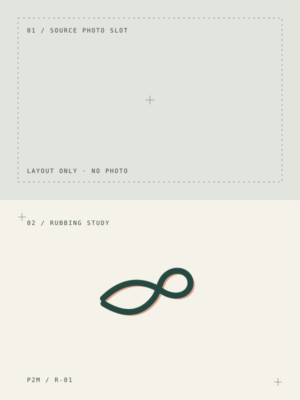

# 案例：窗边的杯子

**构图与符号推导示意，不含实拍原片；不是模型实测。**

- **假设输入**：一张窗边陶杯的照片，杯口是两个微偏移的弧，杯柄围出一个清楚的负空间，窗影斜穿过桌面。
- **下半怎样提炼**：把杯口弧与杯柄环扣成同一个标识，保留杯柄缺口；用极窄的偏移色层暗示窗影与套色误差。删除桌面纹理、杯身轮廓和窗格，不再摆第二个图形。
- **验收**：把海报缩到手机缩略图，依然能看出杯口与杯柄是一个整体；展开时再看见套色细节。若变成通用咖啡杯图标，就重新对齐原照片里真实的弧度与负空间。
